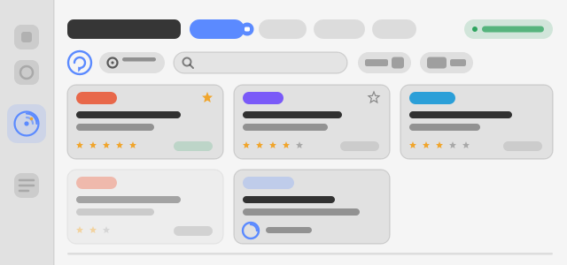

## How it works

```
⟳ Refresh (client)
  → GET /radar-fetch?url=<RSS>   Host-side Node fetch (no CORS)
  → Client parses RSS/Atom, dedupes against stored items, keeps only new ones
  → GET /radar-ai?payload=…      Host calls the DSH default model via ctx.llm.stream
      (6 items/batch × 3 concurrent batches; outputs keep/kind/category/obtain/quality/titleZh/noteZh/reason)
  → keep=false dropped; info items with quality ≤ 1 never enter the store
  → Ingested with Chinese translations → routed into channels
```

Model selection: prefers `agentDefaultModel.currentSelection()` (the DSH default model setting), otherwise the first model of the first registered provider. The About pane shows the model actually used.

## Features

- **Channels**: true freebies / all freebies / deals / open source / headline news / industry info + ★ favorites, with live counts.
- **AI pipeline**: keep filtering (noise/spam dropped) → six content kinds → 27 categories × 6 obtain levels × 1–5 star quality → title/note translated into Chinese → ingested. news/info have explicit bars: forum chatter, daily discussion and help requests are judged noise.
- **🔍 Recheck**: re-runs current AI standards over already-stored items in a channel (favorites are never dropped) — for cleaning up items ingested under older, looser standards.
- **Three-level filters**: kind × category × obtain, folded into a ⚙ popup (button shows the active filter count).
- **Block-word firewall**: matching items are hidden from the list.
- **Source management**: built-in source list (toggle / delete), editable feed URLs, custom RSS sources, per-source refresh, 3-way parallel refresh across sources.
- **Item actions**: ☆ favorite (aggregated in the ★ favorites channel), opening the original marks it read (grayed, sunk), copy redeem codes.
- **Status chip**: one small chip at the toolbar right (live sources while refreshing / summary / failure warning); click for the last 8 refresh log entries.
- **First run**: with no stored data, opening the panel triggers one refresh and then clears the built-in demo items.

## Data

- Durable file: `<DSH profile dir>/resource-radar-data.json` (read/written by the Host `/radar-store` route) — items, favorites, blocklist and custom sources all live there; back up or migrate by copying the file.
- `localStorage` is a fallback cache only (the panel still works when the Host routes are unavailable); the file wins.

## Known limitations

- **Host updates need a full restart**: the DSH desktop host loads the Host half (the three routes in `index.js`) only at process start; after changing Host code, fully restart DeepSeek Harness. The client half updates on page refresh.
- **Cloudflare-protected sites** (LINUX DO, NodeSeek): direct Node fetch gets 403 "Just a moment"; a FlareSolverr deployment is required. These sources ship disabled and say so in their names.
- AI triage quality depends on the model configured in DSH; refresh time and cost grow with the number of new items. RSS fetch caps at 40 items per source.
- No scheduled auto-refresh, push routing or multi-user support.
